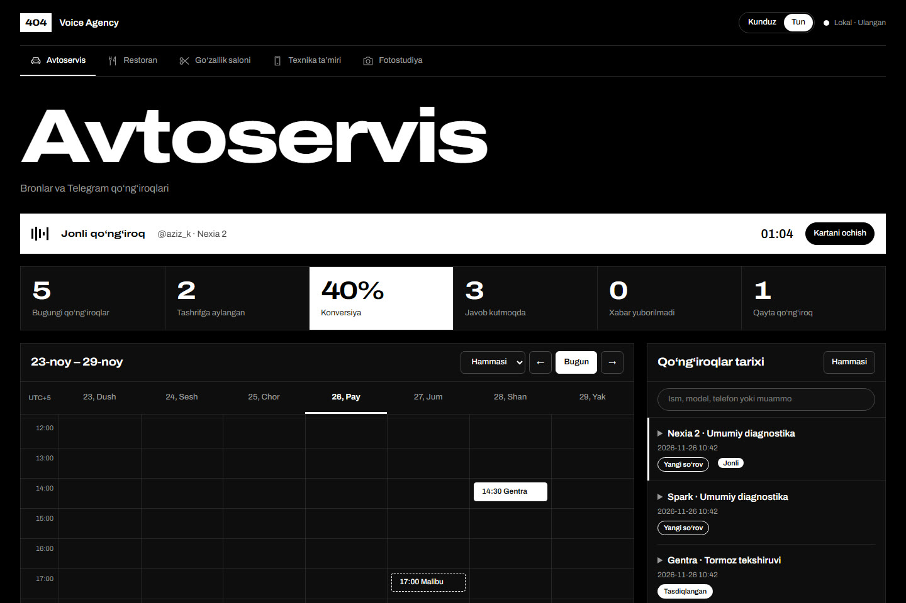
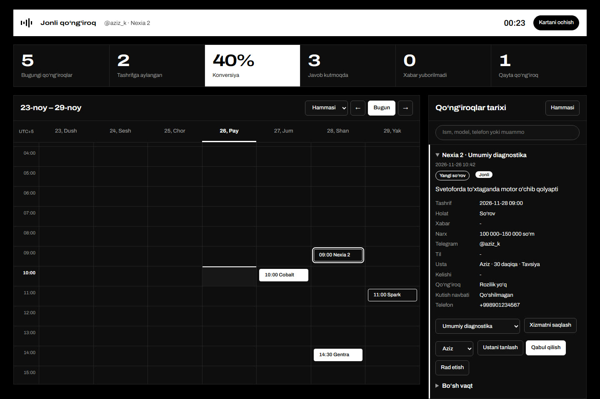
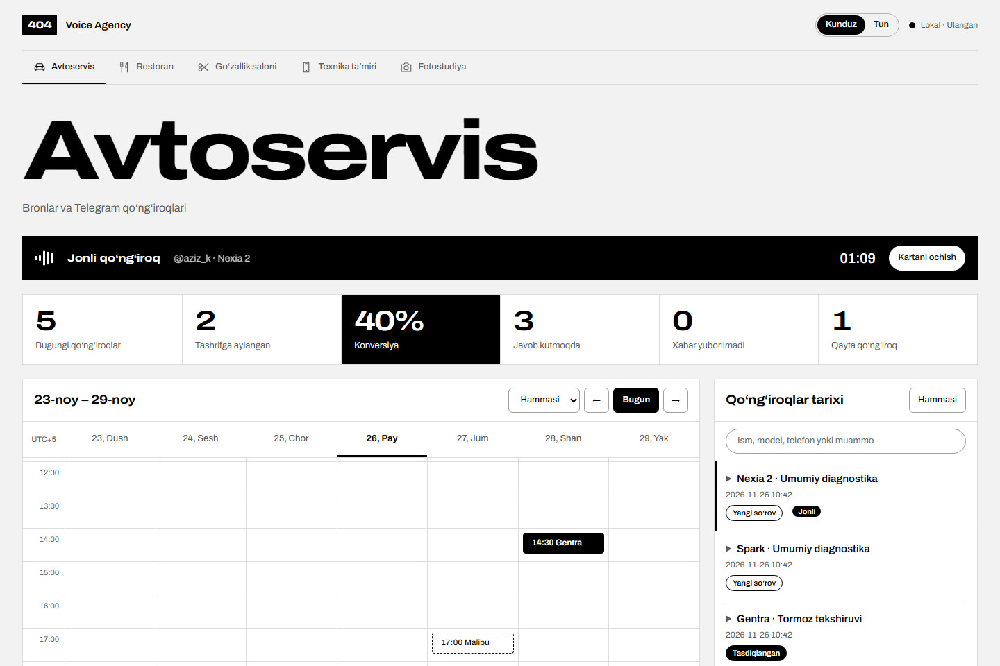
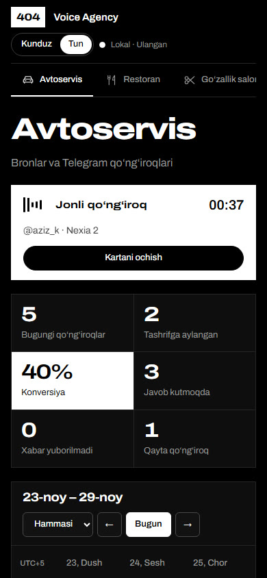
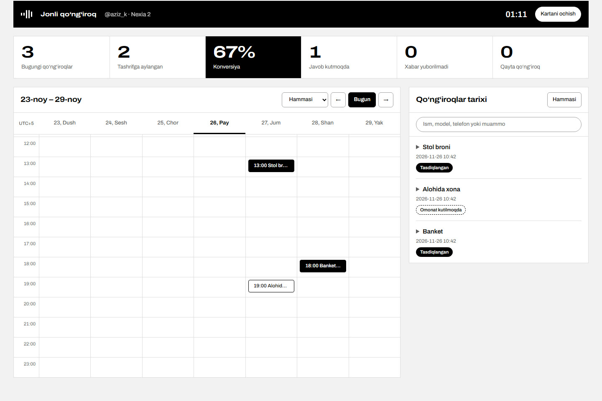

# Voice Agency 404


**Telegram qo‘ng‘iroqlariga o‘zbek tilida javob beradigan AI xodim.** Mijoz Telegram orqali qo‘ng‘iroq qiladi. AI salomlashadi, muammoni tinglaydi, kerakli savollarni beradi, narxni aytadi, bo‘sh vaqtni tekshiradi va so‘rovni kalendarga yozadi. Xodim dashboard’da so‘rovni qabul qiladi, rad etadi yoki boshqa vaqt taklif qiladi. Mijoz javobni Telegram’da oladi.

[🎬 Video (1:28)](https://drive.google.com/file/d/1y3i6GqpcdwkYLAerR32SWI1PhbDxs8sl/view) · [📄 Taqdimot PDF](https://drive.google.com/file/d/1RsMOCRwaQDuzHp2iotwG1XHem5Ruk5No/view) · [📘 Kod qo‘llanmasi](docs/CODE.md) · [▶️ Ishga tushirish](#-ishga-tushirish) · [☎️ Hakamlar uchun sinov](#️-hakamlar-uchun-sinov) · [📝 O‘zgarishlar](CHANGELOG.md)



## Mundarija

1. [Qanday muammoni hal qiladi](#-qanday-muammoni-hal-qiladi)
2. [Qo‘ng‘iroq qanday o‘tadi](#-qongiroq-qanday-otadi)
3. [Dashboard](#️-dashboard)
4. [Beshta yo‘nalish](#-beshta-yonalish)
5. [Ishga tushirish](#-ishga-tushirish)
6. [Hakamlar uchun sinov](#️-hakamlar-uchun-sinov)
7. [Arxitektura va kod](#-arxitektura-va-kod)
8. [Xavfsizlik va maxfiylik](#-xavfsizlik-va-maxfiylik)
9. [Natijani qanday o‘lchaymiz](#-natijani-qanday-olchaymiz)
10. [Cheklovlar](#️-cheklovlar)
11. [Kelajak rejasi](#️-kelajak-rejasi)
12. [Video va taqdimot](#-video-va-taqdimot)

## 🎯 Qanday muammoni hal qiladi

Kichik biznesda telefonga ko‘pincha xodimning o‘zi javob beradi. Usta mashina tagida, oshpaz oshxonada, sartarosh mijoz bilan band. Shu paytda kelgan qo‘ng‘iroq javobsiz qoladi va mijoz boshqa joyga ketadi.

| Muammo | Voice Agency 404 nima qiladi |
| --- | --- |
| Xodim band, qo‘ng‘iroq javobsiz qoladi | AI Telegram qo‘ng‘irog‘ini darhol ko‘taradi va o‘zbekcha gaplashadi. |
| Muammo, narx va vaqt turli xabarlarda yo‘qoladi | Alomat, model, narx, sana va telefon bitta kartaga yoziladi. |
| Ustaga ustma-ust ish berib qo‘yiladi | Xizmat davomiyligi bo‘yicha bo‘sh vaqt tekshiriladi. Bir ustaning tashriflari to‘qnashmaydi. |
| Mijoz kelmay qoladi, vaqt bo‘sh turadi | Bir soat oldin eslatma boradi. Kelolmasa, kutish navbatidagi rozi mijozlarga bo‘sh vaqt taklif qilinadi. |
| Mijoz odam bilan gaplashmoqchi | Dashboard’da qayta qo‘ng‘iroq vazifasi ochiladi. |

## 📞 Qo‘ng‘iroq qanday o‘tadi

1. **Jiringlash.** Telefon jiringlayotganda Gemini Live’ga ulanish ochiladi va salom oldindan tayyorlanadi. Gemini tayyor bo‘lmasa, qo‘ng‘iroq jim qoldirilmaydi, rad etiladi.
2. **Salom.** Mijoz go‘shakni olishi bilan salom darhol eshitiladi.
3. **Til.** AI qisqa o‘zbekcha salomdan keyin mijoz gapirgan tilga o‘tadi: o‘zbekcha, ruscha yoki inglizcha.
4. **Savollar.** Muammoni tinglaydi va yetishmagan tafsilotni so‘raydi: model, alomat, mehmonlar soni yoki xona.
5. **Narx.** `quote` vositasi orqali demo tarifidan narx oralig‘ini aytadi.
6. **Vaqt.** Mijoz aytgan aniq soatni tekshiradi. Band bo‘lsa, eng yaqin bo‘sh vaqtni taklif qiladi.
7. **Tasdiq.** Bron tafsilotlarini qayta o‘qiydi va mijoz tasdiqlagach `save_details` bilan saqlaydi.
8. **Xayrlashuv.** AI xayrlashgach go‘shakni o‘zi qo‘yadi. Murojaat dashboard’da paydo bo‘ladi.

Mijoz gapira boshlasa, AI ovozi darhol to‘xtaydi va AI tinglashga o‘tadi. Suhbat yozuvi kartaga saqlanadi.

## 🖥️ Dashboard

Dashboard faqat shu kompyuterda, `http://127.0.0.1:8744/` manzilida ochiladi. Kunduz va tun rejimi bor, telefonda ham ishlaydi.



- **Jonli qo‘ng‘iroq paneli.** Kim gaplashayotgani, suhbat vaqti va «Kartani ochish» tugmasi. AI mijozga o‘zi qo‘ng‘iroq qilganda ham ko‘rinadi.
- **Ko‘rsatkichlar.** Bugungi qo‘ng‘iroqlar, tashrifga aylanganlar, konversiya, javob kutayotganlar, yuborilmagan xabarlar va qayta qo‘ng‘iroqlar.
- **Haftalik kalendar.** Usta yoki xona bo‘yicha filtr. Tasdiqlangan bron to‘liq, taklif qilingan punktir, rad etilgan ustidan chizilgan. Hozirgi soat belgilanadi.
- **Qo‘ng‘iroqlar tarixi.** Ism, model, telefon, muammo yoki taom bo‘yicha qidiruv.
- **Murojaat kartasi.** Xizmatni o‘zgartirish, ustani tayinlash, **Qabul qilish**, **Rad etish**, **Bo‘sh vaqt** orqali boshqa vaqt taklif qilish, omonatni qayd qilish va qayta qo‘ng‘iroqni bajarilgan deb belgilash.

| Kunduzgi rejim | Telefonda |
| --- | --- |
|  |  |

Skrinshotlardagi barcha mijozlar, raqamlar va bronlar demo ma’lumotlar.

## 🏪 Beshta yo‘nalish

Dashboard tepasida yo‘nalishni tanlang. Tanlov shu Telegram akkauntiga keyin keladigan qo‘ng‘iroqlarga amal qiladi. Faol suhbat o‘z yo‘nalishida davom etadi. Har yo‘nalishning o‘z xizmatlari, narxlari, ish vaqti, xodimlari va kalendari bor.

| Yo‘nalish | Xizmatlar | Kim yoki qayer | Ish vaqti |
| --- | --- | --- | --- |
| Avtoservis | Diagnostika, tormoz, moy almashtirish, elektr | Aziz, Bekzod | 09:00–18:00 |
| Restoran | Stol, alohida xona, banket | Asosiy zal, Oila xonasi, Banket zali | 10:00–23:00 |
| Go‘zallik saloni | Soch turmagi, manikyur | Malika, Dilnoza | 09:00–18:00 |
| Texnika ta’miri | Telefon va noutbuk diagnostikasi | Kamol, Sardor | 09:00–18:00 |
| Fotostudiya | Portret va guruh fotosessiyasi | Oq studiya, Katta studiya | 09:00–21:00 |



**Restoranda** xona, mehmonlar soni, kelish va tugash vaqti hamda taomlar ro‘yxati yoziladi. Banket yoki alohida xona uchun xodim omonatni kartadan qayd qiladi, keyin bronni tasdiqlaydi. Narx va omonatlar `business_profiles.py` faylida.

## ▶️ Ishga tushirish

Kerak bo‘ladi: Windows 10 yoki 11, internet, Google akkaunti (Gemini kaliti uchun) va ikkita Telegram akkaunti: biri robot uchun, ikkinchisi qo‘ng‘iroq qilish uchun. Python shart emas, kerak bo‘lsa avtomatik o‘rnatiladi.

1. Repozitoriyni klonlang yoki **Code → Download ZIP** orqali yuklab, arxivdan chiqaring.
2. **`start-demo.bat`** faylini ikki marta bosing. Qolgan hammasini oyna o‘zi so‘raydi:

| Bosqich | Nima bo‘ladi | Sizdan nima kerak |
| --- | --- | --- |
| 1. Python | Python 3.14 bo‘lmasa, `winget` bilan avtomatik o‘rnatiladi va `.venv` yaratiladi. | Hech narsa. |
| 2. Paketlar | Telethon, py-tgcalls, google-genai va boshqalar o‘rnatiladi. Birinchi marta bir necha daqiqa oladi. | Kutish. |
| 3. Gemini kaliti | [aistudio.google.com/apikey](https://aistudio.google.com/apikey) brauzerda ochiladi. Kalit kiritilgach, Google’da tekshiriladi. | **Create API key** → nusxalash → oynaga qo‘yish. |
| 4. Telegram API | [my.telegram.org/apps](https://my.telegram.org/apps) ochiladi. `api_id` va `api_hash` formati tekshiriladi. | Raqam bilan kirish → istalgan nomli ilova yaratish → `api_id` va `api_hash` ni nusxalash. |
| 5. Telegram login | Robot ishlaydigan akkauntga ulanadi va akkaunt nomini ko‘rsatadi. | Telefon raqami, Telegram’ga kelgan kod, kerak bo‘lsa ikki bosqichli parol. |
| 6. Ishga tushish | Robot qo‘ng‘iroq kuta boshlaydi, dashboard `http://127.0.0.1:8744/` brauzerda o‘zi ochiladi. | Ikkinchi akkauntdan qo‘ng‘iroq qilish. |

Kalit noto‘g‘ri kiritilsa, oyna yopilmaydi, sababini aytib qayta so‘raydi. Keyingi startlarda hech narsa so‘ralmaydi: saqlangan kalitlar va sessiya tekshiriladi va robot darhol ishga tushadi. To‘xtatish uchun **Ctrl+C** bosing.

| Buyruq | Vazifasi |
| --- | --- |
| `start-demo.bat --reset` | Kalitlarni yoki Telegram akkauntini almashtirish. |
| `start-demo.bat --check` | Sozlamalarni tekshirish, ishga tushirmasdan. |

Telegram aloqasi uzilsa, robot 5 soniyadan keyin o‘zi qayta ulanadi. Log `.data/robot.log` faylida. Brauzer ochilmasin desangiz, `VOICE404_NO_BROWSER=1` qo‘ying. Avvalgi ovoz modelini sinash uchun `.env` ichiga `GEMINI_LIVE_MODEL=gemini-3.1-flash-live-preview` yozing. Standart model `gemini-3.8-live`, ovoz Puck.

## ☎️ Hakamlar uchun sinov

1. Ikkinchi Telegram akkauntidan robot ulangan akkauntga qo‘ng‘iroq qiling va ayting: *«Cobalt’im tormoz bosganda chiyillayapti. Ertaga 14:30 da ko‘rib bera olasizlarmi?»*
2. AI yetishmagan savolni beradi, narxni aytadi va vaqtni tekshiradi. *«Bo‘ldi, rahmat»* deng. AI xayrlashib, go‘shakni o‘zi qo‘yadi.
3. Dashboard’da yangi karta va kalendardagi so‘rovni ko‘ring.
4. **Qabul qilish** vaqtni band qiladi va mijozga Telegram’da usta, sana va soat boradi. **Rad etish** mijozga bu vaqtda qabul qilib bo‘lmasligini bildiradi.
5. **Bo‘sh vaqt** orqali boshqa vaqt taklif qiling. Mijoz *«Bo‘ladi»* deb javob bergach, vaqt band bo‘ladi.
6. Mijoz tasdiq xabaridagi **KOCHIR** kodini yuborsa, vaqtni ko‘chirish so‘rovi ochiladi. Yangi taklif tasdiqlanguncha eski bron saqlanadi.

Demo narxlari faqat ko‘rik yoki ish haqi uchun. Detal va yakuniy ta’mir narxi usta ko‘rgandan keyin aytiladi.

## 🧩 Arxitektura va kod

```
Mijoz (Telegram) ──qo‘ng‘iroq──► telegram_call_test.py ──audio──► gemini_voice.py ◄──► Gemini Live
                                        │                               │
                                        │ xabarlar, eslatmalar          │ quote · save_details · finish_call
                                        ▼                               ▼
                                 service_desk.py  ◄──── SQLite (.data) ────►  dashboard.html (127.0.0.1:8744)
```

| Fayl | Vazifasi |
| --- | --- |
| `start-demo.bat` | Bitta tugma bilan ishga tushirish: muhit, kalitlar, login, robot va avtomatik qayta ulanish. |
| `telegram_login.py` | O‘zbekcha sozlash ustasi: kalit sahifalarini ochadi, Gemini kalitini tekshiradi, Telegram’ga login qiladi (`--check`, `--setup`, `--reset`). |
| `telegram_call_test.py` | Qo‘ng‘iroqni ko‘taradi, ovozni uzatadi, ikkinchi qo‘ng‘iroqni kutishga qo‘yadi, Telegram xabarlari, eslatmalar va chiquvchi qo‘ng‘iroqlarni boshqaradi. |
| `gemini_voice.py` | Gemini Live bilan jonli suhbat, audio formatini o‘zgartirish, AI vositalari va xayrlashuvda go‘shakni qo‘yish. |
| `operator-prompt.md` | AI xodimning xulqi, savollari va qoidalari. |
| `service_desk.py` | SQLite baza, narxlar, bo‘sh vaqt tekshiruvi, Telegram xabar navbati, kutish navbati va lokal HTTP API. |
| `business_profiles.py` | Beshta yo‘nalish, 13 ta xizmat, narxlar, xodimlar va ish vaqti. |
| `hold_audio.py` | Ikkinchi qo‘ng‘iroq uchun kutish e’loni va musiqasi. |
| `dashboard.html` | Xodim paneli: kalendar, tarix, jonli qo‘ng‘iroq va murojaat kartalari. |
| `test_service_desk.py` | Jadval, taklif kodlari va xavfsizlik uchun 10 ta test. |

**Lokal API.**

| So‘rov | Vazifasi |
| --- | --- |
| `GET /api/requests` | Barcha murojaatlar: kalendar va tarix uchun. |
| `GET /api/live` | Hozirgi jonli qo‘ng‘iroq. |
| `GET /api/business` | Yo‘nalishlar va faol yo‘nalish. |
| `POST /api/decision` | Xodim qarori: qabul, rad, taklif, usta, omonat, menyu. |
| `POST /api/business` | Faol yo‘nalishni almashtirish. |

Har bir funksiya, qo‘ng‘iroq bosqichlari, `.env` sozlamalari va kengaytirish yo‘llari **[docs/CODE.md](docs/CODE.md)** da batafsil yozilgan.

Testlarni ishga tushirish:

```powershell
.\.venv\Scripts\python.exe -m unittest test_service_desk -v
```

## 🔒 Xavfsizlik va maxfiylik

- Kalitlar `.env` da, Telegram sessiyasi `.telegram/` da, mijozlar bazasi `.data/` da. Uchalasi ham Git’ga kirmaydi.
- Dashboard faqat `127.0.0.1` da ochiladi va faqat `127.0.0.1` va `localhost` Host nomlariga javob beradi. Bu DNS rebinding orqali ma’lumot o‘qishni to‘sadi. POST so‘rovlarda Origin tekshiriladi, so‘rov hajmi 2 KB bilan cheklangan.
- Telegram javobi jo‘natuvchi va taklif kodi bo‘yicha tekshiriladi, begona odam bronni tasdiqlay olmaydi.
- Suhbat paytida audio Gemini Live’ga uzatiladi. Boshqa hech qayerga yuborilmaydi.

## 📊 Natijani qanday o‘lchaymiz

Prototip hali haqiqiy biznesda sinalmagan. Pilotda quyidagilarni o‘lchaymiz:

- **Qo‘ng‘iroqdan tashrifga** = tasdiqlangan tashriflar ÷ kelgan qo‘ng‘iroqlar.
- **Bo‘sh vaqtni qayta to‘ldirish** = kutish navbatidan tasdiqlangan bronlar ÷ bo‘shagan vaqtlar.
- **Tezlik** = tasdiqqacha o‘tgan vaqt va xodimning bitta murojaatga sarflagan daqiqalari.

**Misol.** Haftasiga 100 ta qo‘ng‘iroqdan 20 tasi javobsiz qoladi deylik. AI shu 20 tadan 6 tasini tashrifga aylantirsa, bu **6 ta qo‘shimcha bron**. Bekor qilingan 10 ta vaqtdan 3 tasi navbat orqali to‘lsa, **3 ta bo‘sh vaqt to‘lgan** bo‘ladi.

## ⚠️ Cheklovlar

- Demo Gemini’ning bepul imkoniyatlariga tayanadi. Jonli qo‘ng‘iroqda kechikish, noto‘g‘ri eshitilgan so‘z yoki ovoz uzilishi bo‘lishi mumkin.
- Robot va dashboard ishlashi uchun kompyuter yoqiq va dastur ochiq turishi kerak. Eslatma va tashrif qo‘ng‘iroqlari ham shunga bog‘liq.
- Narxlar demo uchun. Omonatni xodim o‘zi qayd qiladi, onlayn to‘lov hali yo‘q.
- Ikkinchi qo‘ng‘iroqni kutishga qo‘yish ikki telefon bilan jonli sinalmagan.

## 🛣️ Kelajak rejasi

- **Yaqin vaqtda:** bitta haqiqiy biznesda pilot, o‘zbekcha suhbatlarni baholash, audio sifatini yaxshilash.
- **O‘rta muddat:** oddiy telefon raqami (SIP), Click va Payme orqali omonat, CRM va n8n integratsiyasi, bir nechta filial, o‘lchov paneli.
- **Uzoq muddat:** ko‘p biznes uchun bulutli xizmat (SaaS), yangi yo‘nalishlar, ko‘proq tillar, qo‘ng‘iroqlar analitikasi va murakkab holatda suhbatni jonli xodimga uzatish.

Batafsil reja [docs/CODE.md](docs/CODE.md#kelajakda-nimalar-qilish-mumkin) oxirida.

## 🎞️ Video va taqdimot

- **Final video**, Full HD, 1:28: [Google Drive](https://drive.google.com/file/d/1y3i6GqpcdwkYLAerR32SWI1PhbDxs8sl/view) · [GitHub’dagi siqilgan nusxa](docs/404-final.mp4)
- **Taqdimot**, 17 slayd: [Google Drive](https://drive.google.com/file/d/1RsMOCRwaQDuzHp2iotwG1XHem5Ruk5No/view) · [docs/final-pitch.pdf](docs/final-pitch.pdf)
- **HTML slaydlar:** [pitch deck](docs/pitch-deck.html) va [texnik pitch](docs/technical-pitch.html). Yuklab olib brauzerda oching, **← / →** bilan almashtiring, **F** bilan to‘liq ekran.

Video 3D sahnalarda loyihani ko‘rsatadi: tungi javobsiz qo‘ng‘iroq, AI bilan suhbat, bo‘sh vaqt tekshiruvi, bron, dashboard’da qabul qilish va Telegram tasdig‘i. Suhbat ovozlari Voicelab TTS bilan sahnalashtirilgan, dashboard kadrlari demo ma’lumotlar bilan olingan.

## Kutish musiqasi (ixtiyoriy)

Demo bitta faol va bitta kutayotgan qo‘ng‘iroqni qo‘llaydi. Kutishni yoqish uchun foydalanishga ruxsatingiz bor audioni shu formatga aylantiring va robotni qayta ishga tushiring:

```powershell
New-Item -ItemType Directory -Force .data
ffmpeg -i "musiqa.mp3" -ar 48000 -ac 1 -f s16le .data/hold-music.pcm
ffmpeg -i "elon.mp3"   -ar 48000 -ac 1 -f s16le .data/hold-announcement.pcm
```

E’lon bir marta o‘qiladi, musiqa esa navbat kelguncha takrorlanadi. Birinchi suhbat tugagach, kutayotgan mijoz AI bilan ulanadi.

---

**404 jamoasi** · [MIT litsenziyasi](LICENSE) · Suhbat savollarini tuzishda [Olamavto](https://olamavto.uz/uz/service) servisining ochiq yozilish jarayonidan foydalandik.
