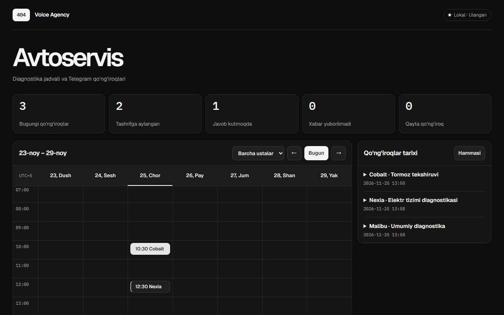

# Voice Agency 404

**404 jamoasi yaratgan o‘zbekcha ovozli avtoservis yordamchisi.** Mijoz Telegram orqali qo‘ng‘iroq qiladi. AI muammoni eshitadi, ustaga kerakli tafsilotlarni so‘raydi va tashrif so‘rovini kalendarga yozadi. Usta sayt orqali so‘rovni qabul qiladi, rad etadi yoki boshqa vaqt taklif qiladi.

[Pitch deck](docs/pitch-deck.html) · [Windows ishga tushirgichi](start-demo.bat) · [Demo ssenariysi](#-hakamlar-uchun-sinov)

## 🎞️ Pitch deck

[HTML faylini](docs/pitch-deck.html) GitHubʼdan yuklab olib brauzerda oching. **← / →** bilan slaydlarni almashtiring, **F** bilan to‘liq ekranga o‘ting. To‘qqiz slaydda muammo, AI qo‘ng‘irog‘i, usta kalendari, kutish navbati, pilot o‘lchovlari va kengaytirish rejasi bor. Slaydlar oflayn ochiladi. Jonli dashboard havolasi lokal demo ishga tushganda ishlaydi.

## 🎬 Bitta tugma bilan demo

1. **Python 3.14 x64** va Windows Python Launcher o‘rnatilgan bo‘lsin.
2. Repozitoriyni klonlang yoki **Code → Download ZIP** orqali yuklab, arxivdan chiqaring.
3. **`start-demo.bat`** faylini ikki marta bosing. Birinchi ishga tushirishda Python paketlari o‘rnatiladi. Oyna sizdan Gemini kaliti, Telegram API ID va API hash’ni so‘raydi. Telegram API ma’lumotlari [API development tools](https://my.telegram.org) orqali olinadi.
4. Telegram raqamingizni, kelgan login kodini va kerak bo‘lsa ikki bosqichli tasdiqlash parolini o‘sha oynaga kiriting. Keyingi startlarda lokal sessiya qayta ishlatiladi.
5. Robot avtomatik qo‘ng‘iroq kutadi va [ishchi dashboard’i](http://127.0.0.1:8744/) brauzerda ochiladi. Ishni tugatganda **Ctrl+C** bosing.

Ishga tushirgich kalitlarni lokal `.env` fayliga yozadi. Telegram sessiyasi va mijozlar bazasi ham kompyuterda saqlanadi. Uchala ma’lumot Git’dan chiqarilgan. Suhbat paytida audio Gemini Live’ga uzatiladi. Dashboard faqat lokal manzilda ishlaydi.

## ☎️ Hakamlar uchun sinov

1. Ikkinchi Telegram akkauntidan robot ulangan akkauntga qo‘ng‘iroq qiling. *“Cobalt’im tormoz bosganda chiyillayapti. Ertaga 14:30 da ko‘rib bera olasizlarmi?”*
2. AI yetishmagan savolni beradi va demo tarifidan narx aytadi. Qo‘ng‘iroq tarixi va tashrif so‘rovi dashboard’da ko‘rinadi. *“Bo‘ldi, rahmat”* deb suhbatni yakunlang.
3. **Qabul qilish** vaqtni band qiladi va mijozga Telegram’dan aniq sana va soatni yuboradi. **Rad etish** so‘ralgan vaqtda qabul qilib bo‘lmasligini bildiradi.
4. **Bo‘sh vaqt** orqali boshqa vaqt taklif qiling. Mijoz Telegram’dagi taklifga *“Bo‘ladi”* deb javob bergach, vaqt band qilinadi. Bir ustaning tashriflari to‘qnashmaydi. Xabar yuborilmasa kartadan qayta uriniladi.

Demo tariflari ko‘rik yoki ish haqi uchun. Detal va yakuniy ta’mir narxi ustaning ko‘rigidan keyin aniqlanadi.

## 🧩 Kod tuzilishi

| Fayl | Vazifasi |
| --- | --- |
| `start-demo.bat` | Lokal Python muhitini tayyorlaydi, paketlarni o‘rnatadi, login va demoni boshlaydi. |
| `telegram_login.py` | API qiymatlarini qabul qiladi va shaxsiy Telegram sessiyasini yaratadi. |
| `telegram_call_test.py` | Qo‘ng‘iroqni ko‘taradi, ovozni uzatadi, dashboard’ni ochadi va Telegram xabarlarini boshqaradi. |
| `gemini_voice.py` va `operator-prompt.md` | Jonli suhbat, mijoz gapirganda AI ovozini to‘xtatish, tarifni olish va so‘rovni yozish. |
| `service_desk.py` | SQLite, tariflar, vaqt tekshiruvi, Telegram xabar navbati va lokal HTTP API. |
| `dashboard.html` | Monochrome haftalik kalendar, qo‘ng‘iroqlar tarixi va usta amallari. |

`GET /api/requests` kalendar va tarixni yangilaydi. `POST /api/decision` usta qarorini saqlaydi. Telegram javobi jo‘natuvchi va taklif bo‘yicha tekshiriladi. Suhbat savollarini tuzishda mahalliy servisning ochiq yozilish jarayonidan foydalandik. [Olamavto](https://olamavto.uz/uz/service)

## 🚧 Prototipdan katta workflow’gacha

Bu **Voice Agency g‘oyasining bitta ishlaydigan prototipi**. Hozirgi demo bitta avtoservis va ikki usta jadvalini qamrab oladi. Keyinchalik n8n yoki boshqa workflow tizimlari bilan CRM, ombor, to‘lov, eslatma va vazifa taqsimotini ulash mumkin. Shu yondashuvni turli bizneslarga moslab, administratorning qo‘ng‘iroq qabul qilish, ma’lumot yig‘ish, jadval tuzish va mijozga javob berish kabi kundalik ishlarini avtomatlashtirishni ko‘zlayapmiz. Murakkab yoki istisno holatlarda qaror xodimga uzatiladi.

Hackathon demosi Gemini’ning bepul imkoniyatlariga tayanadi. Jonli qo‘ng‘iroqda javob kechikishi, ayrim so‘zlar noto‘g‘ri eshitilishi yoki ovoz uzilishi mumkin. Bunga model bilan birga aloqa sifati va audio integratsiya ham ta’sir qiladi. Moliyalashtirish bo‘lsa, 404 jamoasi barqarorroq ovoz modelini sinash, o‘zbekcha suhbatlarni baholash va audio sifatini yaxshilash ustida ishlaydi.

**404 jamoasi** · [MIT litsenziyasi](LICENSE)

## Ikki ustali demo

- Aziz umumiy diagnostika va tormoz bilan ishlaydi. Bekzod moy almashtirish va elektr diagnostikasini oladi. Xizmatga qarab 30–60 daqiqa ajratiladi.
- AI xizmat narxi bilan birga bo'sh vaqtlarni tekshiradi. Dashboard'ni usta bo'yicha filtrlash mumkin.
- Tasdiqlangan tashrifga bir soat qolganda Telegram eslatmasi yuboriladi. Lokal demo shu vaqtda ishlab turishi kerak.
- Mijoz tasdiq xabaridagi KOCHIR kodi bilan vaqtni o'zgartirishni so'raydi. Usta yangi vaqt taklif qiladi. Mijoz yangi taklifni tasdiqlaguncha eski bron saqlanadi.
- AI usta bilan gaplashish so'rovini dashboard'da qayta qo'ng'iroq vazifasiga aylantiradi. Usta vazifani bajarilgan deb belgilaydi.

## Usta tayinlash va tashrif qo'ng'iroqlari

Murojaat kartasida ustani tanlab, Ustani tayinlash tugmasini bosing. Tashrif tasdiqlanganda mijozga usta, sana va soat yoziladi. Qo'ng'iroqqa rozilik bergan mijozga dastur tashrif vaqtida Telegram orqali qo'ng'iroq qiladi. Javob bo'lmasa bron saqlanadi.

Mijoz kela olmasligini aytsa, vaqt bo'shaydi. Dastur shu xizmat bo'yicha ertaroq kelishga va qo'ng'iroqqa rozi bo'lgan mijozlarni navbat bilan chaqiradi. Bitta mijoz aniq rozi bo'lib, vaqt hali bo'sh bo'lsa, jadval yangilanadi va Telegram tasdig'i yuboriladi. Bu funksiya ishlashi uchun lokal robot ochiq turishi kerak.

## v0.2 · Servis jadvali va bo‘shagan vaqtni to‘ldirish

| Muammo | Voice Agency 404 qanday yordam beradi |
| --- | --- |
| Usta band paytida mijozning qo‘ng‘irog‘i javobsiz qolishi mumkin | AI Telegram qo‘ng‘irog‘ini qabul qiladi, o‘zbekcha gaplashadi va murojaatni kalendarga yozadi. |
| Muammo, taxminiy narx va vaqt turli xabarlarda qolib ketadi | Mijoz aytgan alomat, mashina modeli, demo narxi va tashrif so‘rovi bitta kartada. |
| Ustaga ustma-ust ish berilishi | Usta tayinlanadi va xizmat davomiyligi bo‘yicha bo‘sh vaqt tekshiriladi. Tasdiqda Telegram’dan usta ismi, sana va soat yuboriladi. |
| Mijoz kelolmasa, servisning vaqti bo‘sh qoladi | Eslatma yuboriladi. Rozilik bergan mijozga tashrif vaqtida AI qo‘ng‘iroq qiladi. Mijoz kelolmasa, kutish navbatidagi rozi mijozlarga bo‘sh vaqt taklif qilinadi. |
| Mijozga odam bilan gaplashish kerak | Ustaga qayta qo‘ng‘iroq vazifasi ochiladi. Dashboard tashriflar, kutilayotgan javoblar va yuborilmagan xabarlarni ko‘rsatadi. |

## Natijani qanday o‘lchaymiz?

Prototip hozircha real avtoservisdagi mijoz saqlash foizini isbotlamagan. Pilotda quyidagilarni solishtiramiz:

- **Qo‘ng‘iroqdan tashrifga o‘tish** = tasdiqlangan tashriflar ÷ kelgan qo‘ng‘iroqlar.
- **Bo‘sh vaqtni qayta to‘ldirish** = kutish navbatidan tasdiqlangan yangi bronlar ÷ bekor qilingan va qayta taklif qilingan vaqtlar.
- **Xizmat samaradorligi** = kelgan mijozlar ulushi, tasdiqqacha o‘tgan vaqt va xodimning bitta murojaatga sarflagan daqiqalari.

**Hisob namunasi.** Bir haftada 100 ta qo‘ng‘iroq bo‘lib, 20 tasi o‘tkazib yuborilgan deylik. AI o‘sha 20 ta murojaatdan 6 tasini tasdiqlangan tashrifga aylantirsa, bu **6 ta qo‘shimcha bron**. Yana 10 ta bekor qilingan vaqtdan 3 tasi navbat orqali qayta band qilinsa, **3 ta bo‘sh slot to‘lgan** bo‘ladi. Bu ikki ko‘rsatkich alohida yuritiladi, chunki bir mijoz ikkala guruhda ham uchrashi mumkin. Bron va haqiqatan kelgan mijoz ham alohida hisoblanadi.
